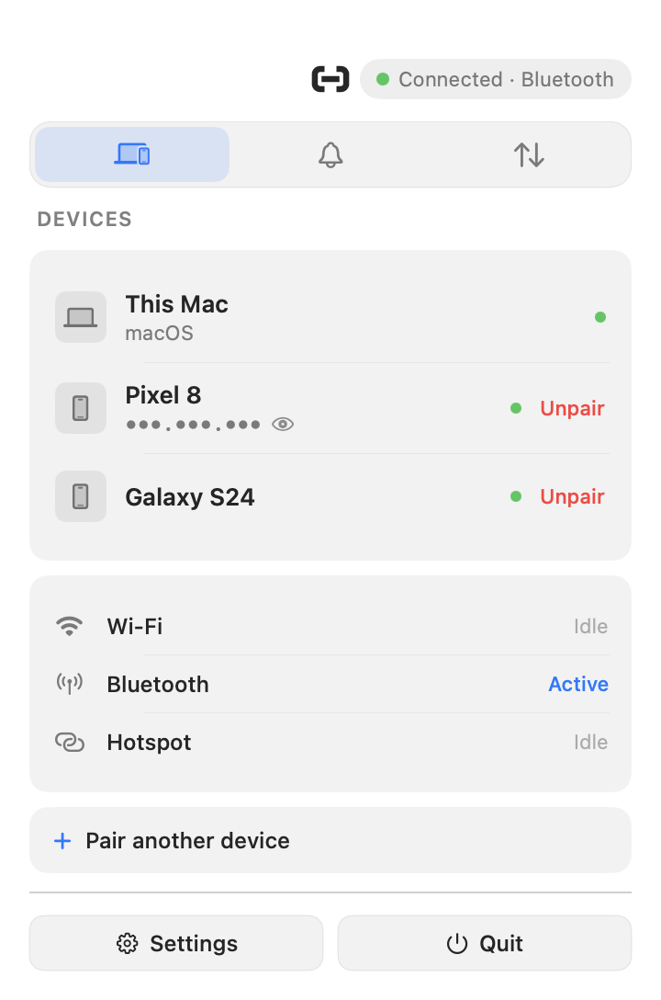
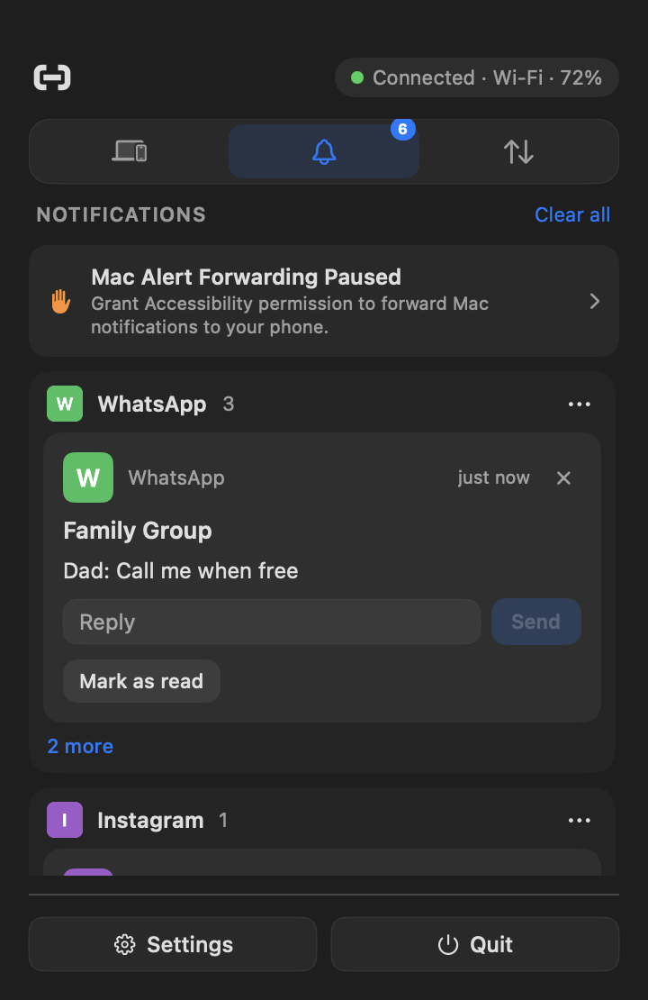
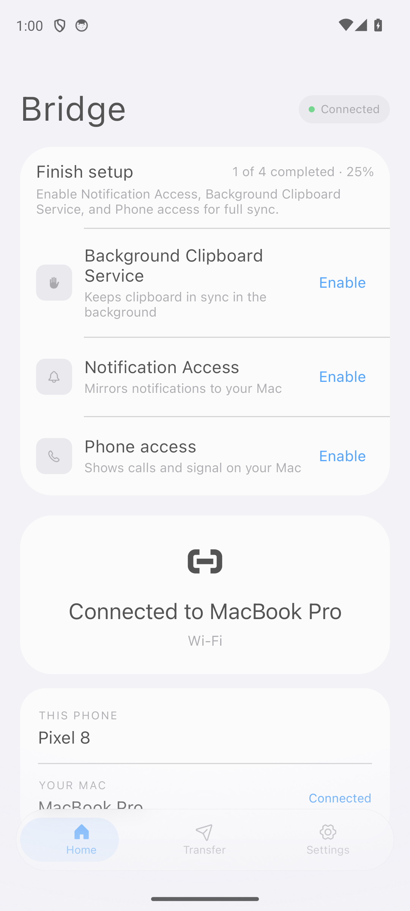
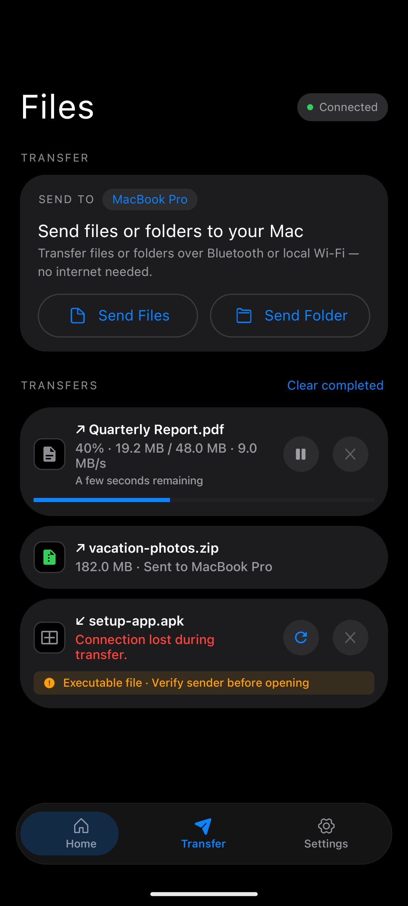
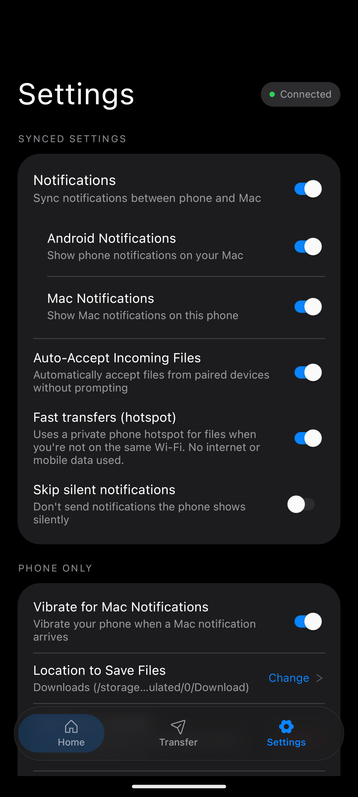

<div align="center">


# Link

**Your Mac and Android phone, linked. Offline, over Wi-Fi, Bluetooth or the phone's hotspot.**

</div>

Link is a private utility that keeps your Mac and Android phone in sync without a cloud account, a server, or an internet connection. Clipboard, notifications, calls, files, and phone status all travel over your local network or a direct Bluetooth link.

---

## Screenshots

<table align="center">
  <tr>
    <td align="center"><br /><sub>Devices</sub></td>
    <td align="center"><br /><sub>Notifications</sub></td>
  </tr>
  <tr>
    <td align="center"><br /><sub>Home</sub></td>
    <td align="center"><br /><sub>Files</sub></td>
    <td align="center"><br /><sub>Settings</sub></td>
  </tr>
</table>

---

## Features

### Clipboard
- Sync text and images in both directions.
- Copy on one device, paste on the other with no extra steps.
- Echo suppression via SHA-256 digests prevents feedback loops.

### Notifications
- Mirror phone notifications into the macOS menu bar popover and as native banners.
- Reply to messages inline without picking up the phone.
- Per-app levels (high, normal, quiet, muted, off) and grouped stacks.
- Optional skip-silent filtering and Mac-to-phone alert mirroring.

### Calls
- See caller info for incoming calls on the Mac.
- Answer, decline, or end calls from the menu bar.
- A ringing banner and a pinned call card keep call state visible.

### Files
- Send multiple files and whole folders, with directory structure preserved.
- Drag and drop onto the Mac menu bar icon, or use the macOS and Android share sheets.
- Encrypted transfer with SHA-256 verification and a confirm prompt for executables.

### Phone status
- Battery level, charging state, carrier, and 5G/LTE network type.
- Signal strength and low-battery alerts.

### Wi-Fi
- Share the Mac's current Wi-Fi password so the phone can join the same network.
- Use the phone's personal hotspot for internet on the Mac when away from home.

---

## How it connects

Link picks the fastest path that is available and falls back automatically.

| Scenario | Messages and control | Files |
| :--- | :--- | :--- |
| Same Wi-Fi network | LAN TCP `:8765` | LAN TCP `:8765` |
| Different networks | Bluetooth LE L2CAP relay | Fast link: the phone's LocalOnlyHotspot joined by the Mac, with Bluetooth fallback |
| No Wi-Fi at all | Bluetooth LE L2CAP relay | Bluetooth LE L2CAP relay |

The Mac advertises itself over Bonjour (`_clipboardsync._tcp`), so no manual IP entry is needed on a shared network. When file transfers are large, the phone can raise a private hotspot so data moves over Wi-Fi speed even while control stays on Bluetooth.

---

## Privacy and security

- No cloud, no accounts, no telemetry, and no update checks. Everything stays on your local network or a direct link.
- Pairing uses a 6-digit code with **SPEKE**, a 2048-bit password-authenticated key exchange, giving perfect forward secrecy.
- After pairing, all control and file traffic is encrypted with **AES-256-GCM** and bound to per-session keys.
- Brute-force defenses include per-IP exponential lockout, a global handshake rate limit, replay-nonce caching, and an 8-second unauthenticated timeout.
- Only private LAN addresses are accepted, and pairing codes are stored with `0600` permissions.

---

## Requirements

| Platform | Requirement |
| :--- | :--- |
| macOS | macOS 13.0 or later (`LSMinimumSystemVersion`) |
| Android | Android 8.0 or later (`minSdk 26`) for Wi-Fi and hotspot features |
| Android Bluetooth | Android 10 or later (API 29) for the BLE L2CAP transport; older versions keep working over Wi-Fi and hotspot |

---

## Build and install

Link is a private app with no public releases. Build it from source.

### macOS

```bash
cd mac-app
make install   # Builds Link.app and installs it to /Applications/Link.app
```

> **Upgrading from an older install:** `Link.app` and the previous `Bridge.app` share the same bundle ID (`com.link.bridge`), so macOS treats them as the same app. Quit the old `Bridge.app` and delete `/Applications/Bridge.app` by hand before or after installing `Link.app`, then launch Link from `/Applications`.

### Android

Enable USB debugging on the phone (Settings, About phone, tap Build number 7 times, then Developer options), connect it, and accept the prompt.

```bash
cd android-app
JAVA_HOME=/opt/homebrew/opt/openjdk@17 ./gradlew assembleOptimized
adb install -r app/build/outputs/apk/optimized/app-optimized.apk
```

**Wireless debugging:** pair once over the network, then install the same way.

```bash
adb pair <phone-ip>:<pairing-port>      # enter the pairing code shown on the phone
adb connect <phone-ip>:<connect-port>
adb install -r app/build/outputs/apk/optimized/app-optimized.apk
```

> **Android 13 restricted settings:** if Accessibility or Notification access looks grayed out after a sideloaded install, open Settings, Apps, Link, the overflow menu, then Allow restricted settings.

---

## Permissions

### macOS

| Permission | Purpose |
| :--- | :--- |
| Bluetooth | Connect to the phone directly when no Wi-Fi is available |
| Location | Read and switch Wi-Fi networks for fast transfers (SSIDs are only visible to apps with Location) |
| Desktop, Documents, Downloads folders | Send files from, and save incoming files to, those folders |

### Android

| Permission or access | Purpose |
| :--- | :--- |
| Notification access | Mirror notifications to the Mac and deliver replies back to apps |
| Accessibility | Detect clipboard copy events on Android 10 and later |
| Bluetooth (scan/connect) | The BLE L2CAP transport used when devices are not on the same network |
| Nearby Wi-Fi devices, location, Wi-Fi state | Join networks, read the current SSID, and run the fast-link hotspot |
| Phone, call log, contacts, answer calls | Caller info and call monitoring |
| Camera | Scan the pairing QR code (frames are decoded in memory and discarded) |
| Notifications, foreground service, wake lock, battery optimization | Keep the sync connection alive in the background |
| Storage | Save incoming files on older Android versions |

---

## Project layout

```
mac-app/       SwiftUI menu bar app and share/quick-action extensions
android-app/   Kotlin app (single-module Gradle project)
design/        Design spec, screenshots, and icon sources
```

---

## Credits and license

Link is based on [Bridge by badruddin-tasnim](https://github.com/badruddin-tasnim/bridge) (MIT License), extended with offline Bluetooth transport, fast-link file transfers, phone-internet sharing, and the features above.

Released under the [MIT License](LICENSE).
